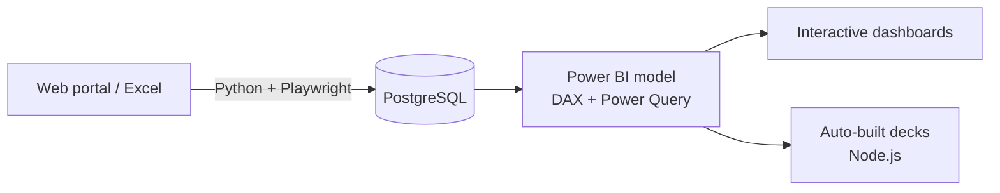

# Hi, I'm John 👋

**I turn raw data into numbers leadership can trust, and I automate the work in between.**

---

## 🚀 At a glance

| | |
|---|---|
| 💼 **Experience** | 8+ years in analytics, 3 years building Power BI models |
| 🏗️ **Focus** | End-to-end BI pipelines, advanced DAX, reporting automation |
| 🎰 **Domain** | Land-based gaming, online casino & sportsbook |
| 👥 **Leadership** | Mentor a team of data analysts |
| 🌏 **Based in** | Philippines (GMT+8) |

## 🧭 What I do

- 🔄 **Own reporting end to end**: Python + Playwright pull the data, PostgreSQL stores it, Power BI turns it into decisions
- 📐 **Advanced DAX**: month-end projections, YoY/MoM variance, coverage and KPI measure families
- 🤖 **Automate the repetitive work**: board decks and weekly reports generated straight from data with Node.js
- ✅ **Numbers you can trust**: reconciliation and anomaly checks before anything reaches leadership
- 🎰 **Domain**: land-based gaming and online casino & sportsbook analytics (GGR, NGR, turnover, hold, promo ROI)

## 📈 Impact highlights

- ⏱️ **Days → hours**: report and board-deck prep after automating extraction and generation
- 🏢 **Multi-brand, multi-site**: one Power BI model covering several brands across hundreds of sites
- 🔍 **Monthly three-way reconciliation**: BI vs accounting vs counterparty invoices, every variance traced to its source

## 🛠️ Tech stack

  

## ⚙️ How I build reports

## 📂 Projects

| Project | Stack | Status |
|---|---|---|
| 📊 **Apex Gaming Co. · Sales Performance Dashboard** Executive overview, month-end projections, site map, promo performance, jackpot analysis and a Q&A assistant (fictional data) | Power BI · DAX · Power Query | 🚧 Coming soon |
| 🔄 **Automated Reporting Pipeline** Scheduled web-portal exports loaded into clean, analysis-ready PostgreSQL tables | Python · Playwright · PostgreSQL | 🚧 Coming soon |
| 🖼️ **Auto-built Report Decks** PowerPoint decks generated straight from data, with built-in quality checks | Node.js · pptxgenjs | 🚧 Coming soon |

## 📚 Currently learning

Statistics & forecasting · advanced SQL window functions

## 🎮 Beyond data

Gamer · Speedcuber (CFOP) 🧩

---

💬 Always happy to connect with people in data, BI and analytics

