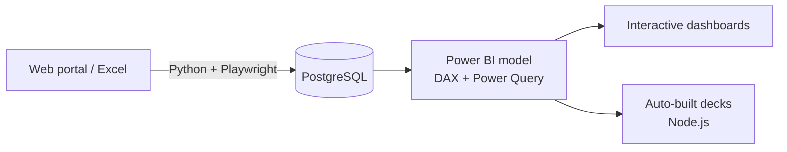

# Hi, I'm John 👋

### Data Analyst & Power BI Developer · Philippines 🇵🇭

**I turn raw data into numbers leadership can trust, and I automate the work in between.**

---

## 🧭 What I do

- 🔄 **Own reporting end to end**: Python + Playwright pull the data, PostgreSQL stores it, Power BI turns it into decisions
- 📐 **Advanced DAX**: month-end projections, YoY/MoM variance, coverage and KPI measure families
- 🤖 **Automate the repetitive work**: board decks and weekly reports generated straight from data with Node.js
- ✅ **Numbers you can trust**: reconciliation and anomaly checks before anything reaches leadership
- 🎰 **Domain**: land-based gaming and online casino & sportsbook analytics (GGR, NGR, turnover, hold, promo ROI)

## 🛠️ Tech stack

## ⚙️ How I build reports

## 📊 Featured project

**Apex Gaming Co. · Sales Performance Dashboard** *(Power BI, fictional data)*

Multi-brand gaming operator dashboard with an executive overview, month-end projections, a site map, promo performance, jackpot analysis and a built-in Q&A assistant.

🔗 Full report and screenshots: *coming soon*

## 📈 Currently learning

Statistics & forecasting · advanced SQL window functions

---

💬 Always happy to connect with people in data, BI and analytics

